# CareVoice

A small backend that turns a nurse's spoken documentation (already turned into text on the phone) into checked,
structured vital signs, and raises alerts when values are out of range.

> "Mrs. Smith, blood pressure 120 over 75, pulse 80, temperature 37 point 2 degrees"
> → `BloodPressure(120/75)`, `Pulse(80)`, `BodyTemperature(37.2 °C)`, all `CONFIRMED`

CareVoice is a portfolio project: a compact system, built the way a production backend is built. It shows how I
design, test, operate and document Kotlin services.

**Stack:** Kotlin · Ktor · coroutines · Arrow · PostgreSQL · MongoDB · RabbitMQ · Redis · OpenTelemetry · Grafana ·
Docker · Kubernetes (Helm, k3d)

## Highlights

- **No lost data.** A transcript, its observations and its event are saved in one transaction (transactional outbox),
  and every retry is safe (idempotency keys, optimistic locking).
- **Built for failure.** Timeouts, retries with backoff, circuit breakers and backpressure on every remote call.
  When a dependency is down, work waits instead of failing, and the demo breaks dependencies on purpose to show it.
- **AI that is never trusted blindly.** Fixed rules extract values first; an LLM (Claude or Gemini) is only a
  fallback, its output passes the same validation, and a nurse confirms it. Alert guidance is retrieval-augmented and
  must cite the care protocol.
- **Observable.** One request can be followed through both services: structured logs, traces and metrics in Grafana.
- **Operable.** Two replicas per service, Helm chart, PostgreSQL with failover, continuous backups and a restore
  drill that proves them.
- **Tested in depth.** Unit, integration, contract (Pact), architecture (Konsist), fault-injection, query-plan and
  load tests.
- **Documented decisions.** 27 Architecture Decision Records, each with its alternatives and costs.

## Architecture



- **[docs/architecture.md](docs/architecture.md)**: architecture, sequence diagrams (submit a transcript, failures
  and retries, concurrent confirmation, protocol guidance) and the Kubernetes deployment.
- **[docs/adr/](docs/adr/README.md)**: Architecture Decision Records: why each technology and pattern was chosen,
  and what it costs.
- **[docs/local-access.md](docs/local-access.md)**: every local URL, demo user and default password in one place.
- **[docs/kubernetes.md](docs/kubernetes.md)**: how Kubernetes works, mapped to this repo, and how to run the local
  k3d cluster.
- **[docs/walkthrough.md](docs/walkthrough.md)**: a guided tour: a live demo in 14 steps (`make demo`), the
  requirements and how they are met, decisions and their costs, open gaps with fixes, questions and answers.
- **[docs/availability.md](docs/availability.md)**: why every service runs as several pods, why two services instead
  of a monolith, what happens when Postgres, MongoDB, RabbitMQ or Redis is down, and how Postgres is backed up.
- **[docs/indexing.md](docs/indexing.md)**: every index and the query it serves, benchmark numbers on 1M rows, and
  the plan tests that keep the indexes in use.
- **[docs/CONTRACTS.md](docs/CONTRACTS.md)**: the binding specification (API, events, configuration, conventions).

| Module | Purpose |
|---|---|
| `domain` | Pure Kotlin: normalize, extract, validate, review policy (~400 data-driven tests) |
| `contracts` | Event and payload types shared by both services |
| `documentation-service` | Ktor + PostgreSQL: auth, transcripts, observations, outbox relay, SSE |
| `alert-service` | Ktor + MongoDB: idempotent event consumer, alert rules, alert API, protocol guidance (RAG) |
| `test-support` | Test buckets, JSON assertions, OpenAPI contract checks, embedded and container databases |
| `architecture-test` | Konsist rules for the hexagonal layering |
| `load-test` | Gatling smoke, load and stress simulations |

## Where to find each concept

`doc` = `documentation-service/src/main/kotlin/com/carevoice/documentation`,
`alert` = `alert-service/src/main/kotlin/com/carevoice/alert`.

| Concept | Where |
|---|---|
| Value classes, smart constructors, "make invalid states unrepresentable" | `domain/.../model/VitalSign.kt` |
| Typed errors instead of exceptions (Arrow's `Either` and `either { ensure() }`, sealed `DomainError`) | `domain/.../model/VitalSign.kt`, `model/DomainError.kt`, ADR-0027 |
| Strategy + Composite pattern | `domain/.../extraction/RuleExtractors.kt`, `alert/domain/AlertRules.kt` |
| Chain of responsibility (rules first, AI fallback) | `domain/.../application/TranscriptProcessor.kt` |
| Transformation (spoken forms → canonical, °F → °C) | `TranscriptNormalizer.kt`, `TemperatureExtractor` |
| Hexagonal architecture, enforced | ports in `*/application/Ports.kt`, adapters in `*/infrastructure`, rules in `architecture-test` |
| AI output is never trusted: same validation as the rules, always human review | `AiVitalExtractor.kt`, `review/ReviewPolicy.kt`, `doc/infrastructure/ai` |
| Transaction (Unit of Work) + transactional outbox | `doc/application/SubmitTranscript.kt`, `doc/infrastructure/persistence/JdbcTransactions.kt`, `doc/outbox` |
| Retry with exponential backoff and full jitter, circuit breakers | `doc/resilience/Backoff.kt`, `Retry.kt`, `CircuitBreakers.kt`, `doc/outbox/OutboxRelay.kt`, `alert/infrastructure/guidance/GuidanceCircuitBreakers.kt` |
| Time limits and cancellation: request deadline, statement timeout, one safe read retry | `doc/api/plugins/RequestDeadline.kt`, `alert/api/RequestDeadline.kt`, `db/migration/V4__statement_time_limits.sql`, `JdbcTransactions.kt` |
| Backpressure: bounded channel, bounded concurrency, prefetch, semaphore | `doc/outbox/OutboxRelay.kt`, `alert/infrastructure/amqp`, `alert/api/Routes.kt` |
| RabbitMQ: publisher confirms, quorum queues, retry tiers (5 s to 30 min), pause during a MongoDB outage, DLQ and replay | `doc/infrastructure/amqp/AmqpEventPublisher.kt`, `alert/infrastructure/amqp` |
| Idempotency (keys, unique indexes, never check-then-insert) | `doc/application/SubmitTranscript.kt`, `alert/application/ProcessObservationEvent.kt` |
| Hot vs cold Flows, SSE with Redis fan-out and `Last-Event-ID` replay | `doc/application/ObservationStream.kt`, `doc/api/routes/StreamRoutes.kt` |
| Caching: Caffeine cache-aside (Decorator), Redis invalidation, `ETag` / `304` | `doc/infrastructure/cache`, `doc/infrastructure/redis` |
| JWT auth with roles, bcrypt, service token, ward isolation (404 not 403) | `doc/infrastructure/auth`, `doc/api/plugins/Security.kt`, `alert/api/Security.kt` |
| AES-256-GCM field-level encryption with key rotation | `doc/infrastructure/crypto/AesGcmFieldEncryptor.kt` |
| HTTP `QUERY` method, RFC 9457 problem details, precise status codes | `doc/api/routes/ObservationRoutes.kt`, `doc/api/Problems.kt` |
| Keyset (cursor) pagination, optimistic locking | `doc/application/PageCursor.kt`, `alert/application/CursorCodec.kt`, `AcknowledgeAlert.kt` |
| Indexes and migrations (Flyway, versioned Mongo runner) | `documentation-service/src/main/resources/db/migration`, `alert/infrastructure/migrations` |
| Index design: ESR, keyset, partial indexes, extended statistics, benchmark, plan tests in CI | [docs/indexing.md](docs/indexing.md), `scripts/db-bench`, `*QueryPlanTest.kt` |
| RAG: chunking, embeddings, small-to-big retrieval, grounding check, evaluation set | `alert/domain/guidance`, `alert/application/GetAlertGuidance.kt`, `alert/infrastructure/guidance` |
| Model provider as an adapter: Claude or Gemini (Template Method, JSON schema, thinking level) | `doc/infrastructure/ai`, `alert/infrastructure/guidance/Gemini*.kt`, [ADR-0025](docs/adr/0025-model-provider-behind-ports.md) |
| Observability: MDC, OTel agent, percentiles, exemplars, dashboards | `doc/infrastructure/tracing`, `*/Dockerfile`, `deploy/grafana` |
| JVM container flags, jlink runtime, slim images | `*/Dockerfile` |
| Multi-pod rules (advisory locks, shared rate limits, fan-out) | CONTRACTS section 9b, `doc/infrastructure/redis` |
| Kubernetes: Helm chart, HPA, PDB, NetworkPolicies, operators | `deploy/helm/carevoice`, `deploy/k8s`, [docs/kubernetes.md](docs/kubernetes.md) |
| Backups: WAL archiving, point-in-time recovery, restore drill, alert rules | `deploy/k8s/databases/postgres.yaml`, `scripts/k8s-pg-restore-drill.sh`, `deploy/k8s/observability/prometheus-rules.yaml`, [ADR-0026](docs/adr/0026-postgres-backups-wal-archiving.md) |
| Availability: replicas, critical vs degradable dependencies, behaviour during outages | [docs/availability.md](docs/availability.md) |

## Run

```bash
cp .env.example .env      # once; local development defaults
make build                # compile, all tests, format check, coverage gate (CI runs the same, split into jobs)
make up-fast              # docker compose: both services (2 replicas each) and every dependency
make monitoring-up        # optional: Uptime Kuma with monitors and a status page
make admin-up             # optional: pgAdmin and mongo-express
make tools-up             # optional: Homepage, one start page with every UI of the stack
make k8s-up               # optional: the same system on a local Kubernetes cluster (k3d)
make k8s-pg-restore-drill # optional: prove the Kubernetes Postgres backups with a point-in-time restore
make security-scan        # optional: ZAP, Trivy and gitleaks reports in build/security
make db-bench             # optional: index benchmark on 1M rows, report in build/db-bench
make demo                 # optional: interactive 14-step live demo (docs/walkthrough.md)
make help                 # every target
```

You need JDK 21 or newer (the bytecode targets Java 21) and Docker. `make k8s-up` also needs k3d, kubectl and helm.

Try the API with the Postman collection in `postman/`: import it, check `demoPassword` (default `admin123`) and run
folder `01 Auth` first. Every local tool (Postgres, RabbitMQ, Grafana, pgAdmin, mongo-express, Uptime Kuma) uses
`admin` / `admin`; the demo users (`nurse.anna`, `nurse.ben`, `lead.clara`) use `admin123`.

### Local URLs (docker compose)

| URL | Also on | Service |
|---|---|---|
| http://api.carevoice.127.0.0.1.nip.io | http://localhost:8080 | documentation-service (Swagger UI at `/docs`) |
| http://alerts.carevoice.127.0.0.1.nip.io | http://localhost:8081 | alert-service (alerts API, `/docs`, health) |
| http://grafana.carevoice.127.0.0.1.nip.io | http://localhost:3000 | Grafana |
| http://rabbitmq.carevoice.127.0.0.1.nip.io | http://localhost:15672 | RabbitMQ management |
| http://traefik.carevoice.127.0.0.1.nip.io | | Traefik dashboard |
| http://status.carevoice.127.0.0.1.nip.io/status/carevoice | http://localhost:3001 | Uptime Kuma status page (`make monitoring-up`) |
| http://pgadmin.carevoice.127.0.0.1.nip.io | http://localhost:5050 | pgAdmin, documentation-service database (`make admin-up`) |
| http://mongo.carevoice.127.0.0.1.nip.io | http://localhost:8082 | mongo-express, alert-service database (`make admin-up`) |
| http://home.carevoice.127.0.0.1.nip.io | http://localhost:3002 | Homepage start page (`make tools-up`) |

Traefik routes the host names on port 80 (`CAREVOICE_HTTP_PORT`). `*.127.0.0.1.nip.io` is public DNS that points to
127.0.0.1, so you need no `/etc/hosts` entries. It does need internet, and some home routers block it (for example
FRITZ!Box DNS rebind protection). In that case set `CAREVOICE_DOMAIN=carevoice.localhost` in `.env` (works in
browsers and curl without DNS) and run `make up-fast`. If port 80 is already taken on your machine, set
`CAREVOICE_HTTP_PORT=8000` in `.env` and add `:8000` to every host-name URL above (also in Postman's `docBaseUrl`).
The `localhost` URLs never change.

### Local URLs (Kubernetes, `make k8s-up`)

| URL | Service |
|---|---|
| http://carevoice.127.0.0.1.nip.io:9080 (https on `:9443`, self-signed) | documentation-service (Swagger UI at `/docs`) |
| http://grafana.carevoice.127.0.0.1.nip.io:9080 | Grafana |
| http://minio.carevoice.127.0.0.1.nip.io:9080 | MinIO console: the Postgres backups (base backups and WAL files) |
| `kubectl -n carevoice port-forward svc/alert-service 18081:8081` | alert-service (only reachable inside the cluster) |

Logins, database connections and more: [docs/local-access.md](docs/local-access.md).

## Design decisions

The full set, with alternatives and trade-offs, is in [docs/adr/](docs/adr/README.md). The short version:

- **The domain has one dependency: Arrow's core library.** It compiles without Ktor, a database or a coroutine library
  (`suspend` is a language feature). Frameworks are details that can be swapped, and an allow-list in the architecture
  test keeps anything else out of the domain.
- **`Either` instead of exceptions for validation.** Invalid input is expected, not exceptional. Exceptions
  (`require`) are only for programming errors, such as a confidence outside 0..1.
- **Arrow's `Either` with the `either { }` builder.** Each validation rule is one `ensure(...)` line, and multi-step
  checks read top to bottom with `bind()` instead of nested `flatMap`s (ADR-0027). The first error wins; nothing is
  accumulated, because the first problem is enough to correct a vital sign.
- **Rules before AI.** Regex rules are fast, free, predictable and explainable. The LLM is only a fallback, and a
  nurse must confirm anything it produces: a wrong value in a care record is worse than a missing one.
- **Retrieval before generation, citations before trust.** Alert guidance comes from the facility's protocols. An
  LLM may phrase it, but every step must cite a retrieved section; otherwise the protocol's own steps are shown.
- **An outage must not use up retries.** When a dependency is down, work waits (the outbox parks its rows, the alert
  consumer pauses) instead of failing. Retries are for errors that retrying can fix.
- **Exhaustive instead of sampled tests where possible.** The blood-pressure rule is checked for every combination
  in range (about 27,000 cases, a few milliseconds).
