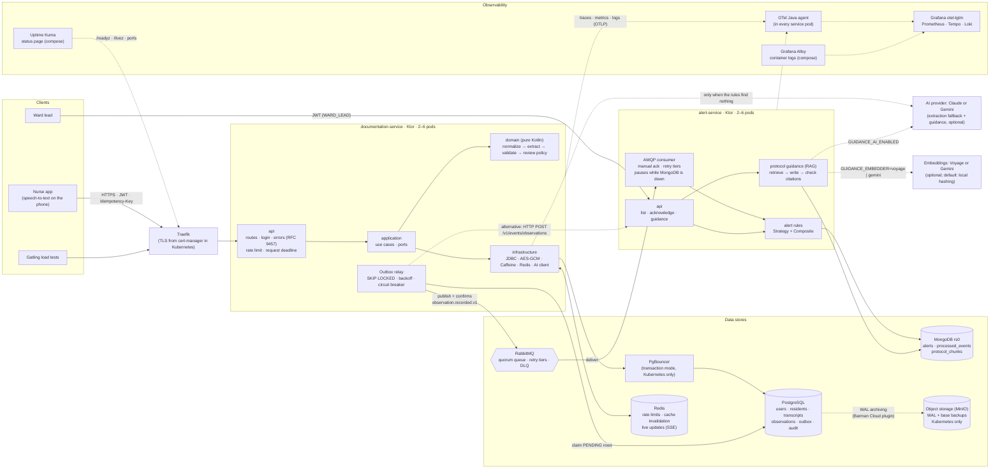
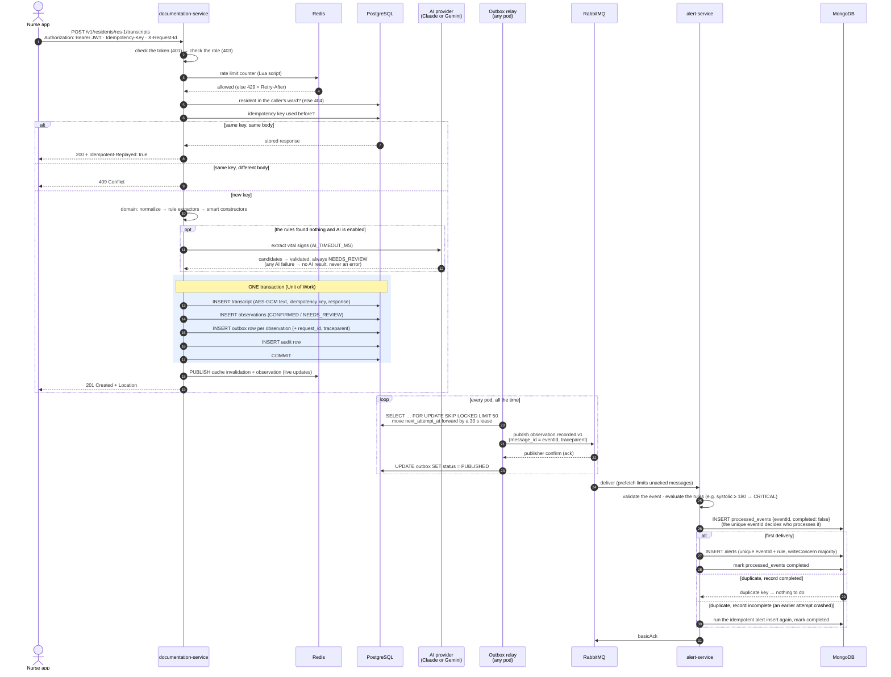
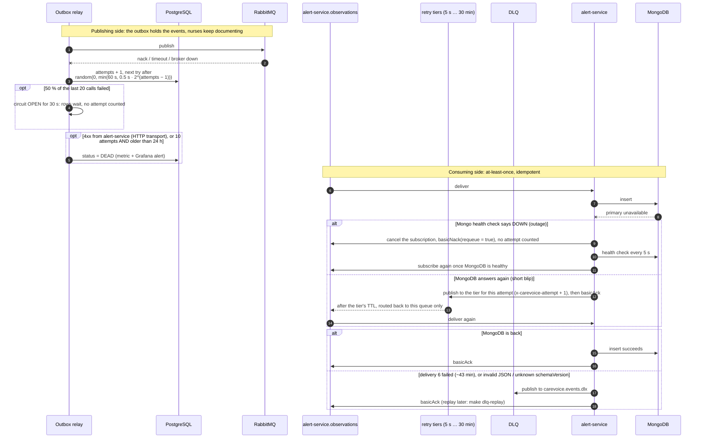
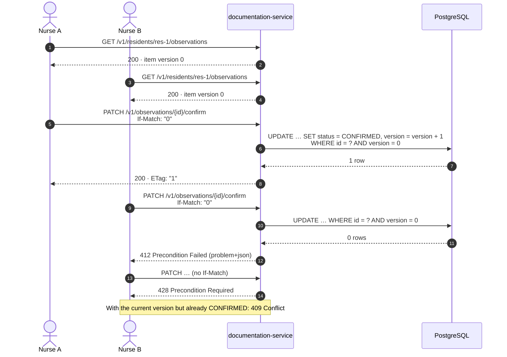
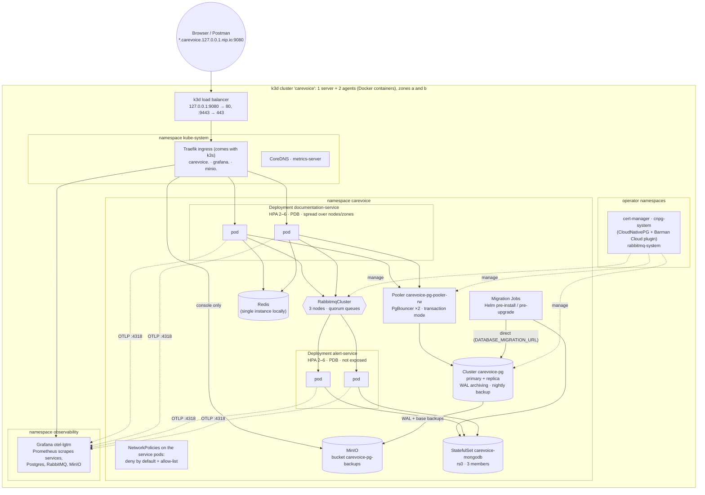
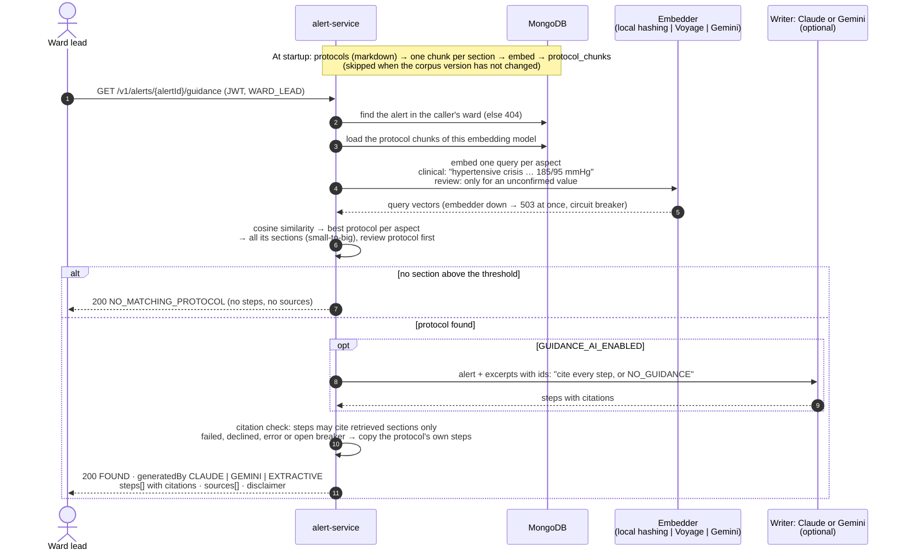

# Architecture

The diagrams are written in Mermaid. GitHub and IntelliJ (with the Mermaid plugin) show them as pictures. The same
sources are in `docs/diagrams/*.mmd`, and each one is also saved as an SVG:
`npx @mermaid-js/mermaid-cli -i <file>.mmd -o <file>.svg -b white`. Keep the code blocks below and the `.mmd` files
identical. The reasons behind each part are in the [Architecture Decision Records](adr/README.md).

1. [System architecture](#1-system-architecture)
2. [Sequence: submit a transcript (happy path)](#2-sequence-submit-a-transcript)
3. [Sequence: failures, retries and dead-lettering](#3-sequence-failures-retries-and-dead-lettering)
4. [Sequence: concurrent confirmation (optimistic locking)](#4-sequence-concurrent-confirmation)
5. [Deployment on Kubernetes](#5-deployment-on-kubernetes)
6. [Sequence: protocol guidance for an alert (RAG)](#6-sequence-protocol-guidance-for-an-alert-rag)

## 1. System architecture

A nurse sends a transcript to documentation-service. The pure `domain` module finds and checks the vital signs, and
the service stores them in PostgreSQL together with outbox rows. The outbox relay publishes events to RabbitMQ.
alert-service reads them, ignores duplicates, and stores alerts in MongoDB. Redis is shared by all pods of
documentation-service. The OpenTelemetry agent sends traces, metrics and logs to Grafana.

For an alert, alert-service can also return guidance: steps taken from the care home's protocols, optionally
rewritten by Claude or Gemini, and always with their sources. In Kubernetes, PostgreSQL also copies its write-ahead
log (WAL) to object storage, so the database can be restored to any point in time.

Read it from left to right. The **synchronous path** (solid lines: client → documentation-service → PostgreSQL)
answers the nurse. The **asynchronous path** (outbox → RabbitMQ → alert-service → MongoDB) raises alerts. The nurse
never waits for it, and it never makes her request fail, even when alert-service is down. Decisions:
[ADR-0003](adr/0003-two-services-hexagonal-architecture.md), [0004](adr/0004-postgresql-for-documentation-service.md),
[0005](adr/0005-mongodb-for-alert-service.md), [0006](adr/0006-transactional-outbox.md),
[0007](adr/0007-rabbitmq-as-event-transport.md), [0025](adr/0025-model-provider-behind-ports.md),
[0026](adr/0026-postgres-backups-wal-archiving.md).

## 2. Sequence: submit a transcript

Things to point out in a walkthrough:
- **Order of the checks (steps 2–5):** 401 → 403 → 404 → business rules. A resident of another ward gives 404, not
  403, so a caller cannot find out which residents exist elsewhere.
- **Idempotency:** the key and the stored response are saved in the same transaction as the data. A repeated request
  gets the original response back ([ADR-0008](adr/0008-idempotency-and-at-least-once-delivery.md)).
- **The AI never blocks documentation:** it runs only when the rules find nothing, and it runs before the transaction,
  so a slow model never holds a database connection. Every AI failure just means "no AI result".
- **One transaction** writes the data *and* the outbox rows, so either both exist or neither does. Nothing is sent to
  RabbitMQ inside the transaction ([ADR-0006](adr/0006-transactional-outbox.md)).
- The nurse gets **201 before** alert-service has seen anything: the alert path is asynchronous.
- The `traceparent` saved on the outbox row continues the same trace in alert-service
  ([ADR-0015](adr/0015-observability-and-tracing-without-a-service-mesh.md)).
- alert-service writes the `processed_events` record **first** and marks it incomplete. The unique index then decides
  which delivery processes the event. If a pod crashes between the two writes, the next delivery finishes the work.
- Time limits: the whole request has a deadline (`REQUEST_TIMEOUT_MS`, 30 s by default, then 503), and each Postgres
  statement is stopped after 5 s.

## 3. Sequence: failures, retries and dead-lettering

There are two independent retry loops:
- The **outbox** retries publishing. It waits longer after each failure (exponential backoff with random jitter) and
  uses a circuit breaker. A row becomes `DEAD` only after 10 attempts *and* 24 hours.
- **RabbitMQ** retries consuming. A failed event waits in one of five retry queues (5 s, 30 s, 2 min, 10 min, 30 min)
  and goes to the dead-letter queue (DLQ) only when delivery 6 fails. `make dlq-replay` sends it back. When MongoDB is
  really down, the consumer pauses instead, so the events wait in the queue and use up no retries.

Neither loop loses a message, and both depend on the consumer ignoring duplicates.

## 4. Sequence: concurrent confirmation

No database lock is held between the GET and the PATCH. The `version` in the `WHERE` clause finds the conflict
(optimistic locking, [ADR-0011](adr/0011-keyset-pagination-and-optimistic-locking.md)).

## 5. Deployment on Kubernetes

The local cluster runs on k3d: three nodes (Docker containers) in two zones, so replicas really spread out, and
stopping a node shows self-healing. The ingress (127.0.0.1:9080/9443) exposes three host names: the
documentation-service API (`carevoice.`), Grafana (`grafana.`) and the MinIO console (`minio.`). alert-service is not
exposed; use `kubectl port-forward` to reach it.

- The services connect to PostgreSQL through PgBouncer. The migration Jobs connect directly
  ([ADR-0016](adr/0016-connection-pooling-pgbouncer-and-mongodb.md)).
- The operators manage the PostgreSQL cluster, the pooler and RabbitMQ.
- PostgreSQL archives its WAL and a nightly base backup to MinIO through the Barman Cloud plugin
  ([ADR-0026](adr/0026-postgres-backups-wal-archiving.md)). `make k8s-pg-restore-drill` proves the restore works.

Step by step: [kubernetes.md](kubernetes.md). Locally, the same services also run in docker compose, with 2 replicas
each behind Traefik ([ADR-0020](adr/0020-deployment-kubernetes-helm-uptime-kuma.md)).

## 6. Sequence: protocol guidance for an alert (RAG)

Retrieval picks the protocol. The writer (Claude or Gemini) only rephrases what was retrieved. The citation check
decides what the ward lead sees: an answer that cites anything that was not retrieved is replaced by the protocol's
own steps ([ADR-0023](adr/0023-rag-protocol-guidance.md)). Circuit breakers make a failing provider cost no waiting
time: a failing writer falls back to the protocol's steps at once, and a failing embedder gives 503 at once.
